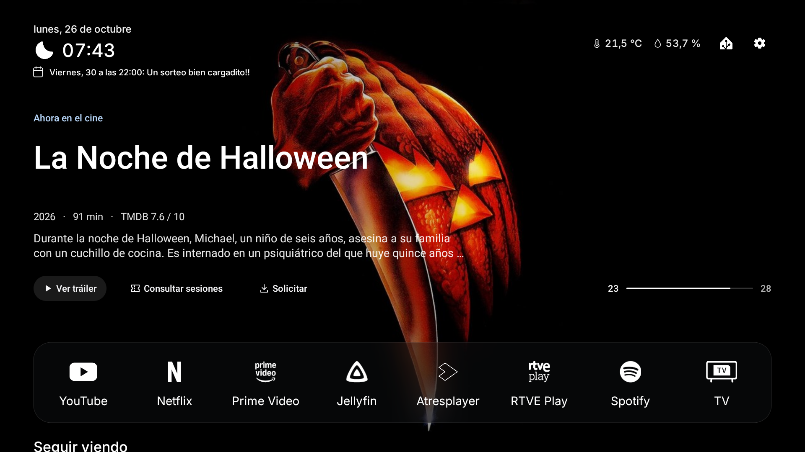

# Free My TV · Mi personalización

Ejemplo de personalización de **Android TV / Google TV** basado en [simbasjungles/free-my-tv](https://github.com/simbasjungles/free-my-tv).

Comparto el diseño y las funciones de mi launcher para que puedas tomarlos como referencia y adaptarlos con un agente de IA, como hice yo. Las claves, servidores, entidades y nombres particulares están sustituidos por **`XXXXX`** o direcciones ficticias `.invalid`.

Incluye estante minimalista, cartelera, Jellyfin, agenda cultural de Madrid, pizarra de experiencias, controles/calendarios de Home Assistant, notificaciones MQTT, salvapantallas y Jarvis.

## Cómo utilizar este ejemplo

1. Clona el repositorio y ábrelo con tu agente de IA.
2. Pídele que revise los marcadores `XXXXX` y adapte el ejemplo a tu TV y servicios.
3. Guarda tus credenciales en `config.properties`, que está excluido de Git. Las entidades y los calendarios se adaptan directamente en el código; [aquí están los archivos](COMMUNITY.md).
4. Cuando lo hayas adaptado, el agente puede compilarlo con `./build.sh` e instalarlo en tu TV, si se lo pides.

Puedes empezar con este mensaje:

> Quiero adaptar este ejemplo a mi TV: https://github.com/TitoTB/free-my-tv. Lee README.md y COMMUNITY.md, revisa los marcadores XXXXX y dime qué datos necesitas para sustituirlos por los de mi instalación. Las credenciales deben quedarse en archivos locales. No compiles ni instales hasta que te lo pida.

Este repositorio es una referencia editable. No se prepara un APK comunitario ni se añade un configurador universal. Los marcadores que aún no se hayan sustituido no se utilizan para conectar ni controlar dispositivos. Un APK que compiles con tus claves debe permanecer privado.

Fondos **Skyline**, de **[Basic Apple Guy](https://basicappleguy.com/)**: [colección original](https://basicappleguy.com/basicappleblog/skyline).

[Archivos que adaptar, privacidad y créditos](COMMUNITY.md) · [Documentación original](README.upstream.md) · [Licencia MIT del código](LICENSE)
